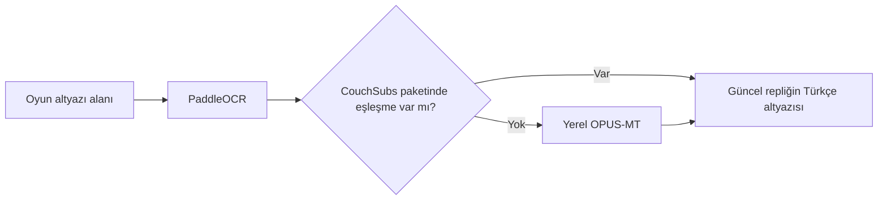

# AccelSubs

AccelSubs (eski adıyla Replik), Windows 10 (2004 ve üzeri) ve Windows 11 x64 için İngilizce oyun altyazılarını yerel OPUS-MT veya Gemini ile Türkçeye çevirir.

## Kurulum ve kullanım

1. Deponun **Releases** bölümünden **AccelSubs-Kurulum-x64.exe** dosyasını indirip çalıştır. PaddleOCR ve PP-OCRv5 Mobile modeli kurulum paketine dahildir. Tam kurulum gerektiğinde Microsoft Visual C++ çalışma zamanını da kurar.
2. Oyunda İngilizce altyazıları aç. AccelSubs varsayılan olarak **Alt** bölgesini okur. Altyazı ekranın ortasındaysa **Orta**, üstündeyse **Üst** seç.
3. Çeviri motorunu seç. Varsayılan **OPUS-MT** CPU üzerinde çalışır. Model, Python ve çeviri kütüphaneleri EXE'ye dahildir. **Gemini** için kendi anahtarını gir. **Çeviriyi başlat** düğmesine bas ve oyuna dön. **Oyuna dönünce bağlan** seçeneği öndeki Veyra veya Remote Play penceresini izler. Oyuncu tanınmazsa **Yenile** ile görüntüyü gösteren pencereyi listeden seç.
4. Son okunan İngilizce satır, Türkçe yanıt ve görüntü okuma / çeviri süreleri kontrol penceresinde görünür. Oyunda yeni bir replik algılandığında kutuda o repliğin çevirisi gösterilir. Önceki replik için geç gelen yanıt elenir. Başka bir uygulamaya geçtiğinde otomatik mod duraklar.

CouchSubs GTA 6 topluluk paketi tam kurulum ve küçük güncelleme sırasında resmî sunucudan alınır ve doğrulanır. Hazır Türkçe eşleşmeler ilk sıradadır. Pakette bulunmayan satırları varsayılan yerel OPUS-MT veya seçili Gemini çevirir. [Paket kaynağı](https://github.com/yorulmazsinan/couchsubs/tree/main/server/packs)

API anahtarı oturum boyunca bellekte tutulur. Seçilen ekran bölgesi yerel olarak okunur. Yalnızca Gemini seçiliyken pakette bulunamayan metinler Google'a gönderilir. Gemini zamanında kullanılabilir bir sonuç vermezse Replik yerel OPUS-MT modelini dener. Tekrarlanan satırlar oturum içinde önbellekten gösterilir.

**Tanı günlüğünü aç** bağlantısı, yakalama, OCR ve çeviri durumunu bilgisayarda tutulan bir dosyada gösterir. Günlüğe altyazı metni, ekran görüntüsü veya API anahtarı yazılmaz.

**OCR ayarları** ekranında PP-OCRv5 Mobile hazır gelir. PP-OCRv6 Small veya Medium seçersen model dosyalarını **İndir** düğmesiyle alabilirsin. İndirilen modeller çevrimdışı çalışır. LunaTranslator’ın görüntü analizi modundaki varsayılan eşikler kullanılır. Görüntü kararlılığı %50, son OCR görüntüsüne benzerlik %95 ve metin farkı 3 karakterdir. Replik bu eşikleri GTA’nın altyazı alanına uygular ve kaçan okumaları yakalamak için 220 ms sonra yeniden kontrol eder. [LunaTranslator OCR ayarları](https://docs.lunatranslator.org/en/ocrparam.html)

## Derleme

### Uygulama güncellemeleri

AccelSubs ve Replik 0.2.1 veya daha yeni sürümler, açılışta ve açık kaldığı sürece altı saatte bir GitHub’da güncelleme arar. Sağ üstteki **Güncelle** düğmesi indirilen dosyayı doğrular ve kurulum sihirbazını açar. AccelSubs 1.0.37 kuruluysa Releases sayfasındaki küçük **AccelSubs-Guncelleme-1.0.38-x64.exe** dosyasıyla yükseltebilirsin.

**Güncelleme önbelleğini temizle** bağlantısı, eski kurulum dosyalarını ve yarım kalan indirmeleri siler. Kurulum tamamlandığında temizlik otomatik olarak da çalışır.

### Windows EXE

Derleme için 64 bit Windows, .NET Framework 4.8, Python/pip ve Inno Setup 6 gerekir. PowerShell'de `./build.ps1 -Compiler 'C:\Program Files (x86)\Inno Setup 6\ISCC.exe'` çalıştır. Kurulum dosyası `dist` klasörüne yazılır.
